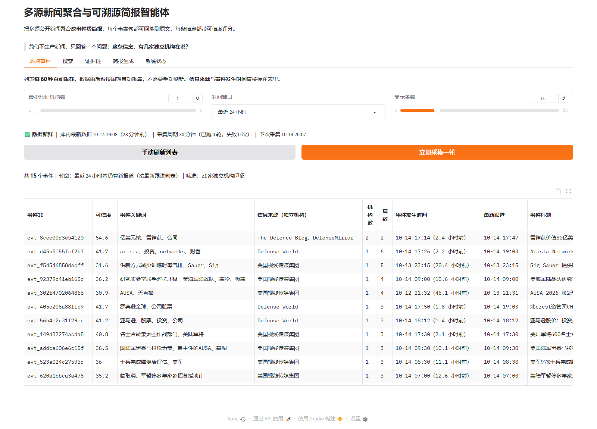
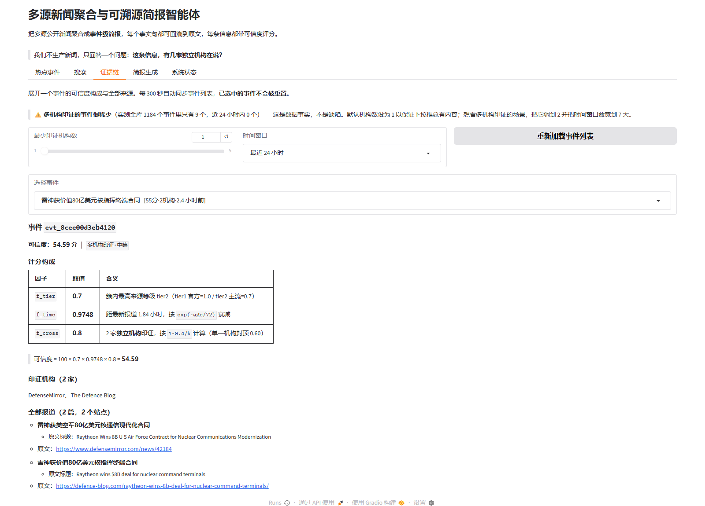
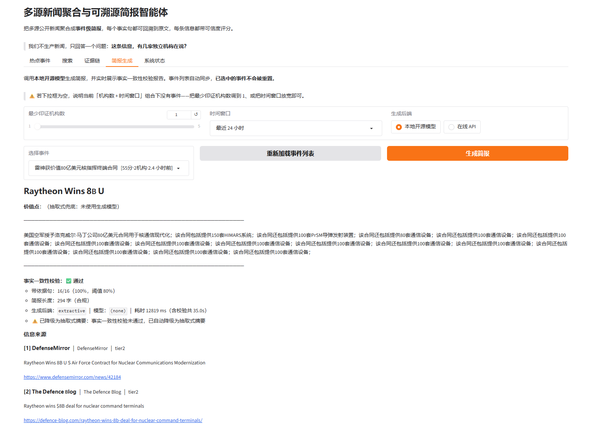

# AIC-NewsBrief

多源公开新闻的**当日聚合**与**可溯源简报**生成框架 —— 用可验证的算法回答一个朴素问题：
**「这条信息，有几家独立机构在说？可信度多高？」**

> 参赛方向：第八届全球校园人工智能算法精英大赛 · 算法创新赛 · **AI+软件创新**
> 开源许可：MIT（见 `LICENSE`）
> 开源与合规说明：见 `docs/开源说明.md`
>
> **开源仓库**：{{REPO_URL}}
> **演示视频**：[`docs/演示视频.mp4`](docs/演示视频.mp4)（4 分 05 秒，字幕已烧录在画面上）
> **技术报告**：[`docs/技术报告.pdf`](docs/技术报告.pdf)（16 页）
> **界面截图**：[`docs/screenshots/`](docs/screenshots/)

---

## 它做什么

把国内外公开新闻源（官方媒体优先）在当天聚合起来，自动产出：

- **短标题**（约 20 字）
- **价值点**（约 20 字）
- **300 字左右的简报**
- **来源标注 + 原文链接**（句级可溯源）

产品定位是「公开信息的**聚合与摘要**」，不做舆情研判、不做意图推测、不做立场性表达。

## 设计原则

1. **可溯源优先**：生成的每个事实句都要能在原文中找到对应片段，校验不过就回退抽取式摘要。
2. **交叉印证可量化**：显式计算「同一事件被几家**独立机构**报道」，并在分数上区别对待孤证与多源印证。
3. **合规优先**：只采集公开发布内容；RSS 优先；遵守 robots.txt 与服务条款；不绕过反爬、不高频请求；仅本地存档用于生成摘要，**不分发原文**。
4. **零重型依赖**：核心算法全部自研，只依赖 `requests` 与 `PyYAML`。

## 自研算法（核心差异化）

| 模块 | 功能 | 关键实现 |
|---|---|---|
| `src/parsers.py` | RSS 2.0 / Atom 1.0 / RDF 解析 | 纯标准库，含正则兜底，**未使用 feedparser** |
| `src/parsers_html.py` | 通用 HTML 列表页抽取 | `html.parser` + 容器归集 + 日期向后携带，**不写死任何站点选择器** |
| `src/dedup.py` | URL 归一化 + 64 位 SimHash | 纯标准库，**未使用 simhash 库** |
| `src/similarity.py` | IDF 加权 TF-IDF + 余弦相似度 | 纯标准库，**未使用 scikit-learn** |
| `src/cluster.py` | 分段桶剪枝 + 并查集事件聚类 | 三阶段合并：内容指纹 → 标题 SimHash → 语义近似 |
| `src/credibility.py` | 权威性 × 时效性 × 交叉印证度 | 可解释评分模型，支持证据链回溯 |
| `src/newwords.py` | **无词典新词发现** | 互信息内聚度 + 左右邻接熵 + 最大 n-gram 碎片消除，从语料自学词表（约 3200 词 / 1300 词对） |
| `src/keywords.py` | 事件关键词标签 | 边界对齐候选 × 簇内文档频率 × IDF × 标题/长度加成 |
| `src/topics.py` | 新闻分区（12 类） | 中英双语加权词表 + 显式语义 tie-break + 次分区 |
| `src/search.py` | 库内检索 | 命中位置加权 + 时效加成 + 同稿折叠 |
| `src/verify.py` | **事实一致性校验** | 加权关键词覆盖率溯源 + 推测性表述检测 + 校验不过自动降级 |
| `src/llm.py` | 生成后端抽象 | 本地开源模型权重 / OpenAI 兼容端点双通道，零硬编码密钥 |
| `src/brief.py` | 结构化简报协议 | 要求模型输出带 `claims` 句级依据的严格 JSON |

### 事件聚类：分段桶剪枝

64 位标题 SimHash 切成 4 段各 16 位，**海明距离 ≤ 3 的两串必有一段完全相同**（抽屉原理），
因此只需在同段同值的桶内精确比较 —— 结果与全量两两比较**等价**，但候选集大幅缩小。

实测（基于 2026-09-24 采集的 705 篇文章）：朴素两两比较 **248,160** 对 → 实际比较 **6,587** 对，**剪到 2.65%**。

### 可信度模型

```
credibility = 100 × f_tier × f_time × f_cross

f_tier  = 簇内最高来源等级权重（tier1=1.0 / tier2=0.7 / tier3=0.4）
f_time  = exp(-age_hours / 72)        0h=1.00  24h=0.72  72h=0.37
f_cross = 1 - 0.4 / k                 k = 不同媒体机构数
```

`f_cross` 在 k=1 时封顶 **0.60** —— **单一机构的信息永远拿不到满分**，
这是整个模型最重要的性质：它把「孤证」和「多源印证」在分数上明确区分开。

**按「机构」而非「站点」计数**是模型的关键修正：实测发现 Army Times / Navy Times /
Air Force Times / Military Times / Defense News / C4ISRNET 同属一家出版集团，
同一稿件会在这些站点同时出现。按站点计数会把「一家机构的报道」算成「5 家源印证」，
系统性高估可信度。机构映射维护在 `config/orgs.yaml`。

所有因子都可通过 `python -m src.cli explain <event_id>` 完整回溯，用于界面展示证据链。

### 开源模型与双后端

摘要生成由**本地部署的开源模型**承担，默认使用
**Qwen2.5-3B-Instruct**（Apache-2.0，**4-bit NF4 量化**后**实测占 1.92 GB** 显存，8 GB 显卡即可运行；
量化不可用时自动回退全精度）。

`src/llm.py` 提供两个可切换后端（配置见 `config/llm.yaml`）：

| 后端 | 说明 |
|---|---|
| `local`（默认） | 从**魔搭 ModelScope** 获取权重、用 `transformers` 本地推理，**可完全离线** |
| `api` | 任意 OpenAI 兼容端点（同样调用开源模型）；密钥仅从环境变量读取，**零硬编码凭据** |

获取权重（带 SHA256 校验与断点续传）：

```bash
# 下载 3B 权重（约 5.75 GB，分两个分片；中断可续传）
python scripts/fast_download.py --model Qwen/Qwen2.5-3B-Instruct \
    --dir models/Qwen2.5-3B-Instruct
# 校验完整性：空洞检测 + 与远端 SHA256 比对
python scripts/check_model_file.py --file model-00001-of-00002.safetensors
python scripts/check_model_file.py --file model-00002-of-00002.safetensors
```

> **为什么必须做完整性校验**：分片下载会先 `truncate` 预分配文件到完整大小，
> 导致“按大小判断是否完整”失效。实测曾因此得到一个大小完全正确、
> 但 **19.2% 数据块全零**的权重文件 —— 模型能加载，却只输出常量 token。

### 事实一致性校验（可溯源的核心）

生成不是“让模型随意写一段话”，而是要求输出带句级依据的严格 JSON：

```json
{ "headline": "…", "value_point": "…", "brief": "…",
  "claims": [{"sentence": "简报中的某一句", "source_index": 1}],
  "conflicts": ["不同来源说法不一致之处"] }
```

`src/verify.py` 再做四类检查（**完全自研，不引入外部模型**）：

1. **溯源校验** —— 每条 claim 用**加权关键词覆盖率**核对能否在该材料原文找到支撑
   （权重取 token 长度，避免“中国”“表示”这类短高频词把分数抬高）
2. **未声明句检测** —— 简报里没被 claims 覆盖的句子单独列出（风险最高）
3. **推测性表述检测** —— 命中`或将/可能会/预计/分析认为/意味着`等词即标记
4. **长度合规** —— 简报长度须落在目标字数 ±25% 内（默认 300 字 → 接受 225~375 字）；
   容差由 `config/llm.yaml` 的 `brief_chars_tolerance` 控制

校验不通过就**自动降级为抽取式摘要** ——
宁可给出不好看但完全忠实原文的简报，也不输出可能失真的生成内容。

## 自动更新：数据与界面都不用手动刷新

热点新闻产品的核心是"新"。库里若没有近 24 小时的数据，可信度模型的时间因子
`exp(-age/72h)` 会把**所有**事件的分数压到个位数 —— 实测把数据放置 5 天后，
原本 40 分的事件只剩 7 分。所以本项目把"定期采集"做成常驻能力，
而不是依赖人记得去敲一次 `pipeline`。

**两层独立的自动机制，频率不同，不要混：**

| 机制 | 实现 | 默认频率 | 作用 |
|---|---|---|---|
| 数据自动更新 | `src/scheduler.py` 的 `AutoUpdater` 守护线程 | 30 分钟 | 跑「采集 → 聚类 → 打分」，保证库里有新鲜数据 |
| 界面自动刷新 | Gradio 6 的 `gr.Timer` | 60 秒（列表）/ 120 秒（状态） | 重读数据库重绘，**只读不写**，代价极低 |

```bash
python -m src.app                        # 默认开启后台自动采集
python -m src.app --interval 10          # 改采集周期（分钟）
python -m src.app --no-auto-collect      # 只保留界面自动刷新，数据靠手动 pipeline
```

启动时若库内数据已超过 24 小时（`--stale-hours` 可调），`AutoUpdater` 会**立刻补跑一轮**，
避免"一打开界面空空如也"；数据还新鲜时先睡一个周期，不白跑全量采集。

`AutoUpdater` 的工程约束（模块文档里逐条写明）：守护线程 + `Event.wait()` 保证可中断退出、
每轮新建 SQLite 连接（连接不能跨线程复用）、`running` 标志防重入（连点"立即采集"不会叠加）、
单轮异常只记录不致命、状态经锁保护的快照对外暴露。
「立即采集」按钮另有一道防护：`AutoUpdater.can_trigger()` 会在**数据还很新鲜**
（默认 5 分钟内，`manual_gap_minutes` 可调）时直接拒绝，并给出说明。
这既省源站流量，也把"按钮被重复触发"变成无害空操作 ——
实测 Gradio 前端在 SSE 流中断重连后会重放 `click` 事件，曾因此在无人点击时触发过一次真实采集。

**24 小时热点**由 `cluster.top_events(hours=24)` 提供，界面上是「时间窗口」下拉框
（24h / 48h / 72h / 7 天 / 不限）。判定口径用**最新跟进**而不是首报时间 ——
一个持续多日的事件，只要今天仍有新报道，它就是今天的热点，不该在第二天突然消失。
列表同时标出**信息来源（参与印证的独立机构）**与**事件发生时间（首报）**。

## 检索、翻译与事件关键词（2026-10-14）

三项面向"更直观好用"的改造，都遵守同一条分工：
**慢的、要调模型的放在离线；界面里只做「读 + 自研算法」**。

### 关键词检索（`src/search.py`）

输入关键词即可检索库内新闻，**命中位置决定排序**：

| 命中位置 | 权重 |
|---|---|
| 标题（含中文译名） | 5.0 |
| 摘要 | 2.5 |
| 正文 | 1.0 |
| 来源名（用于"按来源过滤"） | 0.5 |

再叠加时效加成 `1.5 × exp(-age/72h)` —— 与可信度模型同一衰减尺度，
免得同一个界面里出现两套"新鲜"标准。

**为什么用 `LIKE` 而不是 FTS5。** 库内文章是千级，`LIKE` 全表扫描实测 12~187 ms，
完全够用；而 SQLite 的 FTS5 对中文默认用 `unicode61` 分词器，
会把**一整句中文切成一个 token**，想搜「诺贝尔」得写成 `诺贝尔*` 前缀查询才命中 ——
对普通用户是更差的选择。在当前数据规模下 `LIKE` 是**更准**的方案，不是妥协。

**同一通稿要折叠。** 实测搜 `hypersonic` 时，Sightline Media Group 旗下五家站点
（Defense News / Army Times / Military Times / Navy Times / Air Force Times）
标题完全一样、各占一行。同一篇通稿在不同站点重复上架是国际新闻媒体的常态，
不折叠的话结果页会被同一件事刷屏。现在按 `title_hash` 折叠为一行，并标出「N 站同稿」。

命令行：`python -m src.cli search 无人机 --hours 168`

### 外文自动翻译（`scripts/warm_translations.py`）

外文新闻的标题由**离线批量脚本**译成中文，写入 `articles.title_zh`；
界面一律写 `title_zh or title`，译名为空就显示原文 —— 不阻塞、不报错。

```bash
python scripts/warm_translations.py --limit 300      # 实测约 1.1 秒/条
python scripts/warm_translations.py --hours 168      # 只处理最近 7 天的
python scripts/warm_translations.py --dry-run        # 只看清单，不调模型
python scripts/warm_translations.py --with-summary   # 连正文事实要点一起转写（慢）
```

实测 **1.1 秒/条**（60 条 65.4 秒）。译名落库后还有个附带效果：
事件关键词的挖掘文本会优先取中文标题，所以**英文事件的关键词标签会自动变成中文**。

### 事件关键词（`src/newwords.py` + `src/keywords.py`）

把原来「单一机构·待核实 / 多机构印证·中等」这种**每个事件都一样的通用标签**，
换成按事件内容提炼的关键词：`战略石油储备`、`反无人机合同`、`高超音速威胁`。

**为什么用自研算法而不是大模型。** 标签属于**高频、低容错**的展示元素：
逐事件调模型既慢（一屏十几个事件就是十几分钟），又不稳定（同一事件两次采样措辞不同，
列表会"抖动"，不利于演示与复核）。而关键词本质上是**统计信号** ——
在簇内反复出现、在全局却不常见，这正是 IDF 能算的东西。

**第一版为什么整体废弃。** 第一版在纯中文连续段上枚举 2~4 字滑窗，再把碎片拼回短语。
它产出的是「标题滑窗碎片」：`务院联`、`控机`、`晚不晚`、`将禁止中国测`、
`实验室计划可能扰乱全球电`。根因不是参数没调好，而是**候选没有词边界** ——
滑窗不保证切出来的是词，"短片段 + 合并"也救不回来。全库 5195 个标签里
纯符号占 4.5%、2 字以下占 13%（`习近` 就是「习近平」被切掉一半）。

**现在的做法：无词典新词发现 + 边界对齐候选。** 新增 `src/newwords.py`，
用无词典分词的标准三件套从语料里学出词表：

1. **内聚度（互信息）** —— `log(p(g)·N / (p(左)·p(右)))`，取所有切分点的最小值；
2. **自由度（左右邻接熵）** —— 真词应该能自由搭配；
3. **最大 n-gram** —— 若存在更长的串覆盖本串 ≥90% 的出现次数，本串就是碎片。

`src/keywords.py` 的候选只来自两处：词表里的**词**（2~6 字）与语料中出现 ≥2 次的
**相邻词对**，因此天然落在词边界上。打分 = `簇内文档频率 × IDF × 标题加成 × 长度加成`。

阈值是**标定**出来的：用 28 个已知好词与 21 个手工坏词做对照后，
内聚度分界定在 2.0、再叠加按词长递减的频次门槛，最终**好词命中 33/34、坏词残留 0/23**。

**三处反直觉的发现**（每一条都直接改掉了实现）：子串的内聚度可能高于整词
（`务院` 4.73 > `国务院` 4.26），所以单靠互信息**必然**切出碎片，调阈值无解；
自由度要用 `max` 而非 `min`，否则左邻固定的真专名会被误杀；
虚词表要拆成「不能开头」与「不能结尾」两个集合，否则 `军事基地` 被判为碎片、
残渣 `军事基` 反而留下。

**效果**（同一批事件，CLI 与浏览器实测）：

| 事件 | 第一版 | 现在 |
|---|---|---|
| 洛克希德马丁 PAC-3 边缘拦截弹 | `亿美元核`、`雷神获` | **洛克希德马丁、高超音速威胁、火箭发动机** |
| 莱昂纳多赢得反无人机合同 | `反无人机合`、`同次` | **反无人机合同、leonardo** |
| 美空军基地备战飓风 | `飓风伊斯亚`、`斯亚斯` | **备战飓风、美空军基地、基地撤离** |

**确定性与规模。** 2159 个事件全部产出标签，全库约 **1.2 秒**；用三个不同
`PYTHONHASHSEED` 起独立进程算完整标签，SHA256 摘要逐字节一致
（`events=2159 digest=0bb7eba1bfbe7809`）。词表缓存于 `data/lexicon/newwords.txt`
（`data/` 不入库，克隆后首次运行自动重建，语料规模变化超过 5% 时也会重建）。

> **局限如实说明**：没有命名实体识别，音译专名与地名无法区分，仍有个别残渣（`斯特`）；
> 词表质量受语料量约束，语料增长后自动重建、质量随之改善。
> 三处反直觉发现与 8 个已修缺陷的完整记录见 `docs/技术报告.md` §4.5.4。

### 新闻分区：12 个板块（`src/topics.py`）

界面顶部的板块筛选同样由自研算法完成，而不是让模型逐篇判断：词表按
「分区 → 词 → 权重」组织（3 = 分区特有 / 2 = 强指示 / 1 = 弱指示），
最高分 < 3.0 判为**其他**而不硬塞；第二名 ≥ 3.0 且达主分区 60% 以上则记为**次分区**
（「人工智能用于军事」本就横跨科技与军事，硬塞一类反而失真）。

12 个分区：军事、政治、经济、科技、国际、社会、民生、文化、体育、法治、历史、其他。
实测 3200 篇文章分布为：军事 1266、其他 605、经济 372、政治 274、民生 175、科技 107、
国际 104、文化 97、历史 86、体育 46、法治 44、社会 24。军事占比最高是**数据事实**
而非分类偏差 —— 语料里塔斯社、Defense World、Naval News 等源本身以防务为主。

**三个只有跑真实数据才看得见的坑**：图注被当正文（中新社图片稿里的「（无人机照片）」
让「粉黛花海」被判成军事）；`词 in 文本` 造成子串污染（英文 `art` 命中
`article / start / smart / artillery`）；**用名字做 tie-break 是隐藏的全局偏置** ——
平局时 `sorted()` 按码位排序，`政`(U+653F) < `民`(U+6C11)，于是所有平局里政治恒胜，
改为显式语义优先级后才修掉。

分类是纯算法、全库亚秒级，因此**直接进入每一轮流水线**
（`cli.pipeline` 与 `scheduler` 各调一次，只补 `topic` 为空的新文章）。

## 成果展示



列表每 60 秒自动重载，直接给出四个关键信息：**信息来源（独立机构）**、**事件发生时间（首报）**、
**最新跟进**与实时计算的可信度；顶部状态行自报数据新鲜度与下次采集时间。



上图事件有 6 篇报道、来自 6 个站点，但系统只承认 **2 家独立机构**
（DefenseMirror + 美国视线传媒集团）—— Defense News / Army Times / Military Times /
Navy Times / Air Force Times 同属一家出版集团。若按"站点数"计数，这个事件会被虚报成 6 家印证。
评分构成可逐项验算：`100 × 0.7 × 0.6413 × 0.8 = 35.91`。



上图为一次**真实触发的降级**：模型直出的简报因「句级依据覆盖率不足 + 长度偏离目标」
未通过校验，系统按设计**自动降级为抽取式摘要**，并在界面如实标注
`生成后端: extractive`。这不是失败截图 —— 它正是「宁可不好看也不要失真」这条兜底路径在工作。

其余截图：[`4_status.png`](docs/screenshots/4_status.png)（系统状态）、
[`5_search.png`](docs/screenshots/5_search.png)（检索）。
完整演示见 [`docs/演示视频.mp4`](docs/演示视频.mp4)（4 分 05 秒，字幕烧录在画面上）。

## 目录结构

```
AIC-NewsBrief/
├─ LICENSE                  MIT
├─ .gitignore               数据 / 日志 / 模型权重 / 内部材料不入库（合规要求）
├─ requirements.txt         核心流水线仅 requests / PyYAML；界面与推理另见分组
├─ config/
│  ├─ sources.yaml          数据源定义（enabled 状态全部基于实测，逐条注明原因）
│  ├─ orgs.yaml             source_id -> 媒体机构 映射（交叉印证去重）
│  ├─ llm.yaml              生成后端、字数容差与校验参数
│  └─ anonymize_watchlist.txt.example   匿名化自查清单模板
├─ src/                     23 个模块，全部核心算法自研
│  ├─ config.py / models.py / store.py         配置、数据结构、SQLite 存储与迁移
│  ├─ fetch.py / parsers.py / parsers_html.py  抓取与解析（RSS/Atom/RDF、HTML 列表页）
│  ├─ dedup.py / similarity.py / cluster.py    去重、语义相似度、事件聚类
│  ├─ credibility.py / verify.py               可信度打分、事实一致性校验
│  ├─ newwords.py / keywords.py                无词典新词发现、事件关键词
│  ├─ topics.py / search.py                    12 分区分类、库内检索
│  ├─ collect.py / normalize.py                采集编排、跨语言事实归一化
│  ├─ llm.py / brief.py                        生成后端装配、简报生成与自动降级
│  ├─ scheduler.py / app.py / cli.py           后台自动更新、Web 界面、命令行
│  └─ __init__.py                              包初始化（统一控制台编码）
├─ scripts/                 可复现的核心脚本 + 开发期探针（索引见 scripts/README.md）
├─ docs/
│  ├─ 技术报告.md / 技术报告.pdf                技术报告（九节，16 页）
│  ├─ 开源说明.md / 开源及第三方资源使用清单.md   许可、依赖、数据合规、复现、匿名化
│  ├─ 作品简介与名称.md                        300 字作品简介
│  ├─ 对照实验记录.md + evidence/              模型对照实验的方法与原始输出（可逐行核对）
│  ├─ 演示视频.mp4 / .srt / 脚本.md / 旁白.md   演示视频及其字幕、分镜脚本、配音稿
│  └─ screenshots/                             5 张真机运行截图
└─ （不入库：data/ logs/ models/ dist/ docs/rules/ config/anonymize_watchlist.txt）
```

## 快速开始

```bash
pip install -r requirements.txt

python -m src.cli init                    # 初始化数据库
python -m src.cli health                  # 源可用性体检（只读，不写库）
python -m src.cli pipeline                # 每日任务：采集 -> 聚类 -> 打分

python -m src.cli stats                   # 入库统计
python -m src.cli events --min-orgs 2     # 多机构印证的热点事件
python -m src.cli explain <event_id>      # 某个事件的评分依据与来源清单
python -m src.cli list --hours 24         # 最近入库文章
python -m src.cli events --hours 24       # 24 小时内仍有新报道的热点

python -m src.app                         # Web 界面（自带后台自动采集 + 界面自动刷新）
```

## 数据源现状（2026-09-24 本机实测）

**29 个源启用**，单轮拉取约 3500 条。

| 地区 | 可用源 |
|---|---|
| 中国大陆 | 中国军网、国防部·权威发布、国防部·军事行动、新华网军事/时政/国际、人民网军事/时政/国际、中新网滚动/国内/国际 |
| 境外军事垂直 | Defense News、Army Times、Military Times、Navy Times、Air Force Times、C4ISRNET、DefenseScoop、Defense One、Naval News、Task & Purpose、Defense World、The Defence Blog、DefenceTalk、DefenseMirror、MilitaryLeak |
| 通讯社 / 官媒 | Global Times、TASS |

不可用源已在 `config/sources.yaml` 中置 `enabled: false` 并**逐条注明原因**
（央视网 RSS 已下线、Bing News 已不支持 `format=RSS`、BBC/DW/Reuters/Janes 等连接超时）。

## 实测结论（有日志与脚本可复现）

- **增量去重幂等**：第二轮采集 14 个源返回 304、其余全部命中 URL 去重，**新增 0 条**。
- **"字面重复"几乎都是同机构内部互转**：119 对海明距离 ≤3 的重复对，**全部同机构**；
  跨机构即使放宽到 ≤10 仍为 0 对 → 这是引入语义近似层的直接原因。
- **语义阈值标定**：同事件样例 0.46~0.80，不同事件样例 0.00~0.23，取 0.50 偏保守。
- **跨机构印证检出**：加入语义层后跨机构事件簇 0 → 2，两个均为真实跨机构事件。

标定与分析脚本：`scripts/evaluate_similarity.py`、`scripts/analyze_orgs.py`、
`scripts/dump_context.py`、`scripts/probe_feeds.py`、`scripts/check_html.py`

## 开源与合规

- **许可**：MIT。第三方依赖仅 `requests`(Apache-2.0) 与 `PyYAML`(MIT)。
- **数据**：仅采集公开发布内容；RSS 优先；条件请求降低源站压力；原文仅本地存档、
  **不分发**，故 `data/`、`logs/` 已 `.gitignore`。
- **内容定位**：严格限定为对公开已发布原文的聚合、复述与摘要。单一机构来源会明确
  标记为「单一机构·待核实」。代码与配置不含任何非公开信息。
- **匿名化**：大赛章程第四十四条要求匿名版材料不得出现姓名、指导教师、学校等身份信息。
  项目提供自查脚本：

  ```bash
  copy config\anonymize_watchlist.txt.example config\anonymize_watchlist.txt
  python scripts/check_anonymize.py        # 退出码非 0 表示需清理
  ```

详细说明见 `docs/开源说明.md`。

## 开发状态

| 阶段 | 状态 |
|---|---|
| D1-D2 采集层（源、解析、去重、存储、CLI） | ✅ 完成 |
| D3 自研算法层（聚类、可信度、HTML 抽取、语义相似度） | ✅ 完成 |
| D5-D7 生成层（简报生成、事实一致性校验、翻译、界面） | ✅ 完成 |
| D8 事件关键词 / 新闻分区 / 检索（自研算法补强） | ✅ 完成（2026-10-26） |

完整实测数据、标定过程与缺陷记录见 `docs/技术报告.md`。
