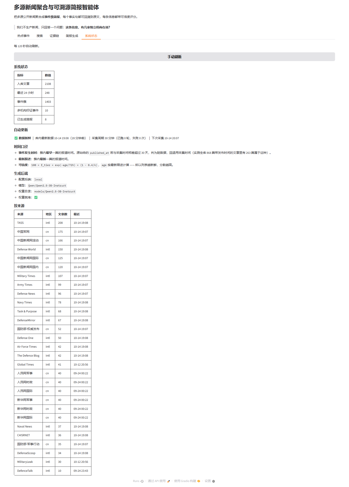

# AIC·AI+开源 技术报告

| 项 | 内容 |
|---|---|
| 团队名称 | （提交时填写） |
| 团队编号 | （提交时填写） |
| 作品名称 | **多源新闻聚合与可溯源简报智能体** |
| 参赛方向 | **（一）开源赋能的 AI 应用创新** |
| 作品形态 | 智能体 / 软件原型（命令行 + Web 界面） |
| 日期 | 2026 年 10 月 |

> 本报告按《AIC·AI+开源技术报告参考大纲》九节撰写，正文控制在 15 页以内。
> 所有统计数字均标注了实测日期与可复现脚本，未给出未经测量的结论。
> **匿名说明**：本报告不含参赛人员姓名、指导教师姓名与学校信息。

---

## 一、作品概述

### 1.1 背景与问题

同一条新闻事件会被多家媒体转载、改写，措辞各异；不同来源之间还可能互相矛盾。
读者面对的实际困难不是"找不到新闻"，而是**无法判断一条信息有几家独立机构在说、
可信度有多高**。

具体而言，现有做法有三个缺口：

1. **聚合工具只做"堆叠"不做"归并"**：把同一事件的十几个版本并列展示，
   不告诉用户"这其实是同一个事件"。
2. **"多家报道"常被高估**：同一出版集团旗下的多个站点会互转稿件，
   按站点数统计会把**一家机构的报道误算成多家印证**。
3. **AI 摘要不可溯源**：生成式摘要读起来通顺，但无法核对哪一句来自哪一篇原文，
   一旦出现幻觉，使用者无从发现。

### 1.2 目标、参赛方向与作品形态

**要解决的问题**：把多源公开新闻在当日聚合为事件级简报，
并且**每个事实句都可回溯到原文、每条信息都带可信度评分**。

**申报方向**：（一）开源赋能的 AI 应用创新 —— 符合该方向"基于开源模型、开源软件，
面向真实场景形成**智能体**"的定位。

**作品形态**：一个可运行的**智能体 + 软件原型**：

- 命令行：`collect`（采集）/ `cluster`（事件聚类）/ `score`（可信度）/
  `brief`（简报生成）/ `daily`（批量）/ `explain`（评分依据）
- 全流程一键：`python -m src.cli pipeline`

### 1.3 核心亮点

1. **三位一体的可溯源链路**：结构化输出协议（要求模型标注每句的依据材料）→
   自研加权覆盖率校验 → 校验不过自动降级为抽取式摘要。
2. **可信度模型按"机构"而非"站点"计数**：`f_cross = 1 - 0.4/k`，单一机构封顶 0.60，
   从模型层面杜绝"同一集团多站点"造成的虚高。
3. **实测驱动的算法演进**：先发现"字面重复全是同机构内部互转"这一数据事实，
   据此才引入语义近似层 —— 每一步改进都有测量依据，而非凭直觉堆模型。

---

## 二、需求分析与总体方案

### 2.1 需求分析

| 目标用户 | 现有做法 | 主要痛点 | 需求优先级 |
|---|---|---|---|
| 关注行业动态的研究/从业者 | 逐个站点浏览、开多个 RSS 阅读器 | 同一事件重复出现，去重靠人工；无法判断信源独立性 | 高：**事件归并 + 可信度** |
| 需要写简报的编辑/学生 | 人工摘抄、或直接用 AI 生成 | 生成内容无法核对原文；存在幻觉风险 | 高：**句级溯源** |
| 开源生态使用者 | 自建采集脚本 | 源维护成本高、抓取不合规风险 | 中：**合规采集 + 可复现配置** |

需求来源为团队自身的日常信息处理实践与公开资料整理（赛题不强制要求企业调研）。

### 2.2 总体方案

| 阶段 | 组件 | 关键处理 |
|---|---|---|
| ① 采集 | 29 个公开源（RSS / HTML） | 条件请求 + URL 归一化去重 |
| ② 存储 | SQLite + 增量去重 | 重复 URL 不重复入库 |
| ③ 聚类 | 三阶段事件归并 | 内容指纹 → 标题 SimHash → 语义近似 |
| ④ 打分 | 可信度模型 | 权威性 × 时效性 × 交叉印证度 |
| ⑤ 生成 | 开源模型 Qwen2.5-3B（4-bit） | 结构化输出协议，要求标注每句取材编号 |
| ⑥ 校验 | 事实一致性校验 | 覆盖率 / 推测性表述 / 长度 三类判据 |
| ⑦ 输出 | 简报 + 评分依据 + Web 界面 | 校验**通过**走此路；**不通过**则降级为抽取式摘要（仍逐句保真原文） |

**模块与技术选型**

| 层 | 模块 | 关键技术 | 自研/开源 |
|---|---|---|---|
| 采集 | `fetch.py` / `parsers.py` / `parsers_html.py` | 条件请求、RSS/Atom 解析、容器化列表页抽取 | **自研** |
| 去重 | `dedup.py` | URL 归一化 + 64 位 SimHash | **自研** |
| 聚类 | `similarity.py` / `cluster.py` | IDF 加权 TF-IDF、分段桶剪枝、并查集 | **自研** |
| 评分 | `credibility.py` | 权威性×时效性×交叉印证度 | **自研** |
| 生成 | `llm.py` / `brief.py` | **开源模型 Qwen2.5-3B-Instruct**（4-bit 量化） + 结构化输出协议 | 开源模型 + 自研协议 |
| 校验 | `verify.py` | 加权关键词覆盖率溯源、推测性表述检测 | **自研** |

### 2.3 可行性与成本

| 项 | 实际投入 |
|---|---|
| 算力 | 消费级笔记本 GPU（RTX 5060 Laptop，8 GB 显存）。3B 模型经 **4-bit NF4 量化**后仅占约 **1.92 GB** 显存（实测），单卡可完整驻留；亦支持纯 CPU（`device_map: cpu`） |
| 数据 | 全部为公开可访问内容，**无采购成本** |
| 软件 | 全部开源：Python / PyTorch / transformers / requests / PyYAML |
| 周期 | 采集与算法层约 3 天，生成与校验层约 2 天，界面与材料约 5 天 |

符合赛题"不要求训练大模型、不要求采购专用硬件、不要求企业级系统"的定位。

---

## 三、AI 技术与开源及第三方资源选择

> 完整的资源清单（名称、版本、来源、许可证、关键义务、自主开发边界、合规状态、
> 开放方式）见技术报告附件：《**开源及第三方资源使用清单**》。

### 3.1 AI 技术的作用

| 环节 | AI 承担的工作 | 为什么必须用 AI | 如何验证输出 |
|---|---|---|---|
| 语义归并 | 判断标题不同但事件相同的报道 | 不同媒体措辞差异无法用字面规则覆盖 | 人工标注样例标定阈值（见 6.1） |
| 简报生成 | 从多篇材料中生成标题/价值点/300 字简报 | 跨语言、跨来源的信息压缩与改写 | **事实一致性校验**（见 3.4） |
| 事实校验 | 不依赖 AI，用加权关键词覆盖率回溯原文 | —— | 可直接人工复核 |

### 3.2 开源资源选型依据

**为什么必须引入开源模型**：本赛道明文规定
"仅使用通用开源软件作为普通开发环境，不等同于 AI+开源 融合创新"，
"仅调用通用模型接口…原则上不认定为充分创新"。
因此本项目把**开源模型作为核心生成组件**，并让开源资源与自研算法形成互补：
**开源模型负责"理解与生成"，自研算法负责"归并、评分与审核"。**

**为什么选 Qwen2.5-3B-Instruct**：

1. **规模适配**：3B 的 bf16 权重约 5.8 GB，直接放入 8 GB 显存、预填充长材料时
   余量不足；改用 **4-bit（NF4）量化**后**实测仅占 1.92 GB**，显存充裕且推理速度良好
   （加载 9~19 秒，详见 5.3 节第（7）项）。加载器在量化不可用时会**自动回退全精度**，
   保证可移植性。赛题明确不以模型参数规模评分，选择「够用且可离线运行」的规模
   更符合学生团队的资源约束。
2. **选型由实测驱动，但我们对结论保持克制**：最初用 1.5B，理由是它在 8 GB 显存下
   无需量化即可运行。随后在**同一批 5 个事件**上做了两轮对照实验，
   按「模型直出且通过校验」计：

   | 轮次 | 长度容差 | 1.5B 一次成型率 | 3B 一次成型率 |
   |---|---|---|---|
   | 第一轮 | ±60%（旧值） | 2/5 | 5/5 |
   | 第二轮 | ±25%（收紧后） | 3/5 | 3/5 |

   **两轮结论相反，说明这个样本量下模型差异不显著 —— 因此我们不宣称 3B「质量更好」。**
   最终选 3B 的依据是两轮都一致的事实：加载更快（8~9 s 对 13~16 s）、
   4-bit 显存 1.92 GB 在 8 GB 卡内余量充足、能力余量更大；
   代价是单次生成慢约 9 秒。完整对照见 5.3 节第（7）项，
   脚本 `scripts/compare_models.py` 随仓库提供、结果可复现。
3. **中文能力**：面向中文输出，Qwen 系列在中文生成上成熟稳定。
4. **许可证友好**：**Apache-2.0**，明确允许商用与再分发，许可义务清晰（保留声明），
   便于合规声明与后续开放。
5. **可完全本地化**：权重来自**魔搭 ModelScope**（国内可直连），
   推理过程不依赖任何在线服务，**演示时无网络也可运行**。

### 3.3 自主开发与权利边界

**清晰区分三类内容**（完整清单见附件）：

| 类别 | 内容 | 权利归属 |
|---|---|---|
| 第三方开源模型 | Qwen2.5-3B-Instruct 权重 | 原权利人，Apache-2.0；**未修改、未微调**（仅推理时做 4-bit NF4 量化） |
| 第三方开源软件 | PyTorch / transformers / requests / PyYAML 等 | 各原作者，按其许可证 |
| **团队自主开发** | 采集与解析、SimHash 去重、IDF 语义相似度、分段桶剪枝聚类、可信度模型、事实一致性校验、结构化输出协议、提示词工程、源配置与阈值标定 | **团队** |

**通用 AI 工具完成部分**：开发中使用生成式 AI 编码助手辅助编写代码与文档。
团队逐文件复核、运行验证与修改；所有算法阈值均由团队编写标定脚本
（`scripts/evaluate_similarity.py` 等）**实测确定**，详见第四节 4.3。

### 3.4 融合方式：不是"调用接口 + 界面包装"

本作品的实质改进在于**把开源模型的输出纳入一个可验证的闭环**，
这是通用 AI 应用不具备的：

```
开源模型生成（可能出错）
        ↓
强制结构化：每条事实句必须声明依据的材料编号 [1][2][3]
        ↓
自研校验：加权关键词覆盖率回溯该材料原文，覆盖率 < 75% 即判定"无依据"
        ↓
自研合规检查：推测性表述（或将/预计/分析认为…）一律标记
        ↓
任一不通过 → 自动降级为抽取式摘要（完全忠实原文）
        ↓
输出：标题 + 价值点 + 300 字简报 + 逐条来源链接 + 可信度评分
```

**对比通用 AI 摘要工具**：它们给出的是"一段看起来正确的文字"；
本作品给出的是"**可以被逐句核对、并对可信度给出量化判断**的信息"。
这也是技术报告第七节"AI 输出风险"的直接应对措施。

---

## 四、设计与实现过程

### 4.1 核心功能与流程

| 命令 | 功能 | 输入 → 输出 |
|---|---|---|
| `health` | 源可用性体检 | 源配置 → 每源条目数/HTTP 状态/耗时（只读不写库） |
| `collect` | 采集入库 | 源配置 → 新增文章（增量去重） |
| `cluster` | 事件聚类 | 窗口内文章 → `event_id` / `cluster_size` |
| `score` | 可信度打分 | 事件簇 → `credibility`（0~100） |
| `brief` / `daily` | 简报生成 | 事件簇 → 标题/价值点/300 字/校验报告 |
| `explain` | 评分依据回溯 | `event_id` → 各因子取值与来源清单 |

### 4.2 关键实现

**（1）事件聚类：三阶段 + 分段桶剪枝**

- 阶段一（精确）：正文指纹 `content_fp` 相同 → 直接合并（跨源整篇转载的强判据），O(n)；
- 阶段二（字面近似）：标题 SimHash 64 位，海明距离 ≤ 3；
- 阶段三（**语义近似**）：IDF 加权余弦 ≥ 0.50。

阶段二的剪枝是本作品的算法贡献点之一：
64 位切 4 段各 16 位，**海明距离 ≤ 3 的两个哈希必有一段完全相同**（抽屉原理），
因此只需在同段同值的桶内精确比较 —— **结果与全量两两比较等价**，但候选集大幅缩小。

**实测**：705 篇文章，朴素两两比较 248,160 对 → 实际比较 6,587 对，
**剪到 2.65%**，聚类耗时不到 1 秒。

**（2）可信度模型**

```
credibility = 100 × f_tier × f_time × f_cross

f_tier  = 簇内最高来源等级权重（tier1=1.0 / tier2=0.7 / tier3=0.4）
f_time  = exp(-age_hours / 72)      0h=1.00  24h=0.72  72h=0.37
f_cross = 1 - 0.4 / k               k = 不同媒体机构数（非站点数）
```

`f_cross` 在 k=1 时封顶 **0.60** —— **单一机构的信息永远拿不到满分**，
这是模型最重要的性质：它把"孤证"与"多源印证"在分数上明确区分开。

所有因子都可通过 `explain` 命令完整回溯，用于界面展示证据链（可解释性）。

**（3）结构化简报协议**：见 3.4 与附件中的提示词与 JSON 结构。

### 4.3 团队分工与过程记录


> **匿名化说明**：按大赛第四十四条，本报告为匿名版，**不出现成员姓名、指导教师姓名与参赛学校**。
> 因此本节以**角色**标识成员；真实身份信息只出现在大赛报名系统的表单里，不进任何文档。

**团队构成（3 人）**

| 角色 | 承担的工作 | 对应产出 |
|---|---|---|
| 成员 A · 算法与数据层 | 数据源调研与可用性实测、采集 / 解析 / 去重、事件聚类、可信度模型、跨语言事实归一化 | `fetch.py` `parsers*.py` `dedup.py` `similarity.py` `cluster.py` `credibility.py` `normalize.py`；§3.1 §3.2 §4.2 |
| 成员 B · 模型与界面 | 开源模型选型与接入、简报生成与校验失败自动降级、事实一致性校验、Web 界面、实时化改造 | `llm.py` `brief.py` `verify.py` `app.py` `scheduler.py`；§3.3 §4.2 §4.4 |
| 成员 C · 文档与合规 | 报告与文档撰写、许可与合规核查、匿名化自查、可复现性整理、演示材料 | `README.md` `docs/` 全套、`scripts/check_anonymize.py` `scripts/check_brief_length.py`；§5—§9 |

> 三人均参与实测与联调；上表按**主要归属**划分，不是排他分工。

**开发时间计划（实际执行，非预估）**

| 阶段 | 时间 | 主要产出 |
|---|---|---|
| D1—D2 采集层 | 09-22 ~ 09-23 | 源可用性实测（29 启用 / 54 淘汰并逐条注明原因）；增量幂等已验证（第二轮新增 0） |
| D3 算法层 | 09-23 ~ 09-24 | 三阶段聚类（指纹 → SimHash → 语义）、分段桶剪枝、可信度模型、语义阈值标定 |
| D4 生成层 | 09-25 ~ 09-26 | 开源模型接入、结构化简报、事实一致性校验与自动降级、跨语言归一化 |
| D5 修复与验证 | 09-26 ~ 09-29 | 统计口径缺陷、长度容差收紧、模型对照实验、Web 界面四页签验收 |
| D6 实时化 | 09-29 | 24 小时热点、后台定时自动采集、界面自动刷新 |
| D7 材料收尾 | 10-12 ~ 10-15 | 截图、技术报告 PDF、公开仓库、演示视频 |

**版本迭代记录（按修复顺序，只列对结论有影响的）**

| # | 版本变更 | 触发原因 |
|---|---|---|
| 1 | 新增 `config/orgs.yaml`，印证度改按**机构**计数 | 实测发现 6 个站点同属 Sightline Media Group，「5 家源印证」是假的 |
| 2 | 聚类新增语义层（IDF 加权余弦 ≥ 0.50） | 实测 119 对 SimHash 近似重复**全部同机构**，跨机构 0 对 |
| 3 | 新增 `normalize.py` 跨语言归一化 | 词面校验把正确的翻译判成幻觉 |
| 4 | 长度容差 ±60% → **±25%**；扩写采纳条件改为「更接近目标且落在容差内」 | 1.5B 扩写失控到 526 字却判「长度合规」 |
| 5 | 对照实验脚本改读 `verification_before_fallback` | 旧口径读 `accepted`，降级后必然通过 → 两模型都显示 5/5 |
| 6 | 时间列比较统一套 `datetime()`（5 处） | 界面「最近 24 小时」= 235，正确值 225 |
| 7 | `top_events(hours=...)` + `earliest` 脏数据防护 | 30% 的 `published_at` 与采集时间差 30 天以上 |
| 8 | 新增 `scheduler.py` 自动采集；`can_trigger()` 误触防护 | 界面重载会重放「立即采集」的 click 事件 |

#### （1）开发方式：实测驱动

本项目的所有结论都建立在可复现的测量之上，而非直觉或惯例：

| 决策 | 依据的测量 | 脚本 |
|---|---|---|
| 选哪些新闻源 | 逐源体检 29 个启用源 + 探测 54 个候选 URL | `probe_feeds.py` / `probe_domains.py` / `cli health` |
| 事件聚类的相似度阈值 | 7 组人工可判断的标题对，测分离度（同事件 0.46~0.80，不同事件 0.00~0.23） | `evaluate_similarity.py` |
| 印证度按机构还是按站点计数 | 测量发现 119 对重复**全部同机构**，跨机构为 0 | `analyze_orgs.py` |
| 生成模型选型 | 同批事件上**两轮**对照 1.5B 与 3B 的一次成型率、字数、溯源达标率（两轮结论相反，已如实记录） | `compare_models.py` |
| 权重文件是否可信 | 远端 SHA256 + 数据块全零率抽样 | `check_model_file.py` |

**失败结论同样保留**：例如探测的 54 个候选源中仅 5 个可用，
央视网 RSS 已下线、Bing News 已停止支持 `format=RSS` 等均记入配置文件的说明字段。

#### （2）关键缺陷由对照实验定位（两个实例）

**实例一：本地模型输出恒为常量 token**

模型能正常加载（338 个权重分片、`cuda:0`、bf16、约 35 tok/s），但输出是随机噪声。
排查过程：先后测试 5 组配置（`dtype` = auto / bf16 / fp16 × 默认 / eager attention ×
贪心 / chat 模板），结果**完全一致** → 据此排除解码参数，判定为权重问题；
再用"均匀抽样读 4 KB 块、统计全零块比例"检测，**400 个采样块中 19.2% 全零**，
定位到分片下载的预分配机制欺骗了"按大小判断完整性"。
修复后加入 SHA256 校验与 `.part` 改名机制。

**实例二：跨语言校验器误杀正确输出**

模型把英文原文正确译成中文后，校验器却判其"无依据"。
排查过程：打印模型原始输出与校验报告，发现覆盖率恒为 0 →
定位到**词面校验在跨语种场景下失效**，据此引入跨语言归一化层。

#### （3）生成式 AI 工具使用说明（规则第三条第（七）项要求）

依据赛题规则："使用生成式人工智能、智能体或自动化工具辅助代码开发、内容制作和
报告编写的，应在技术报告中说明其用途、参与环节及团队的审核、修改和验证工作"。
据实说明如下：

| 项 | 内容 |
|---|---|
| 使用的工具 | **GitHub Copilot**（集成于 VS Code 的生成式 AI 编码助手） |
| 用途 | 辅助编写 Python 代码、撰写文档草稿、排查错误的思路梳理 |
| 参与环节 | 代码编写、脚本编写、文档与报告撰写、缺陷排查 |
| **团队的审核与验证** | 全部纳入作品的代码均**逐文件复核**，并通过以下方式验证：<br>① 静态检查（`python -m compileall`、编辑器诊断）；<br>② **实际运行验证** —— 每个模块都有对应的实测日志（`logs/` 目录）；<br>③ **对照实验** —— 见本节（1）（2），关键结论必须由测量支持；<br>④ 数据与事实核查 —— AI 生成的文字描述均与实际运行输出比对后才写入报告 |
| 来源与权利核查 | AI 辅助生成的代码**未引入任何来源不明的代码片段**；本项目仅使用两个第三方库（`requests`、`PyYAML`）与一个开源模型权重，均已在《开源及第三方资源使用清单》中披露许可与来源。团队确认为原创实现，不存在对第三方成果的不当使用 |
| 对所使用模型/平台许可的遵守 | 使用 GitHub Copilot 时遵守其适用服务条款；**未将 AI 生成内容当然认定为团队自主知识产权**，而是通过上述审核流程确认其正确性与权利边界 |
| 特别说明 | 本作品**运行时**使用的开源模型（Qwen2.5-3B-Instruct）与**开发时**使用的 AI 编码助手是两回事：前者是作品的组成部分，已在开源清单中披露；后者仅是开发工具 |

#### （4）上述过程的可复现性

本节提到的全部脚本均随仓库提供（`scripts/` 目录），运行时产生的日志均保留在
`logs/` 目录（**不随仓库分发**，供团队与评审复核）。第三方只需按
`docs/开源说明.md` 第五节步骤即可复现全部测量。


---

### 4.4 实时化改造：24 小时热点、自动更新与时间口径修复（2026-09-29）

**需求。** 把演示形态从"手动跑一次 pipeline 再看"改成"打开就是今天的热点"：
自动获取并更新 24 小时内的热点新闻、界面无需手动刷新、标明信息来源与事件发生时间。

#### 4.4.1 两层自动机制（刻意解耦）

| 机制 | 实现 | 默认频率 | 读写 |
|---|---|---|---|
| 数据自动更新 | `src/scheduler.py::AutoUpdater`（守护线程） | 30 分钟 | 采集 -> 聚类 -> 打分，写库 |
| 界面自动刷新 | Gradio 6 `gr.Timer` | 60 s（列表）/ 120 s（状态） | 只读库并重绘 |

两者职责不同、频率差 30 倍，所以不合并：关掉后台采集（`--no-auto-collect`）时
界面仍会自刷新，只是数据不再变新。

`AutoUpdater` 的四个工程约束与实测：

1. **可中断退出**：`Event.wait()` 而非 `time.sleep()`，`stop()` 实测 **0.000 s** 返回。
2. **每轮新建 SQLite 连接**：`sqlite3` 连接不能跨线程复用；搭配 `timeout=30` 与界面并发读共存。
3. **防重入**：`running` 标志让并发调用返回 `{"skipped": ...}` 而不是叠加流水线。
4. **单轮失败不致命**：异常被吞进 `last_error`，实测连续两轮 `TimeoutError` 后线程仍存活并继续重试。

启动时按 `MAX(fetched_at)` 判断是否超过 `stale_hours`（默认 24 h）：过期则立刻补跑，
否则先睡一个周期。实测数据新鲜时重启服务**不重复采集**（启动日志无 `[AUTO] 第 1 轮开始`）。

#### 4.4.2 24 小时窗口的判定口径

`cluster.top_events(hours=N)` 在 `HAVING` 中按**最新跟进**
（`MAX(COALESCE(published_at, fetched_at))`）过滤，而非首报时间。理由：一个持续多日的事件，
只要今天仍有新报道，它就是今天的热点；若按首报判定，它会在第二天突然消失，
与新闻产品的直觉不符。界面上因此同时给两列：**事件发生时间（首报）**与**最新跟进**。

实测时窗单调性（库内 866 个事件）：

| 时窗 | 6h | 12h | 24h | 48h | 72h | 7d | 14d | 不限 |
|---|---|---|---|---|---|---|---|---|
| 事件数 | 128 | 145 | 190 | 207 | 223 | 735 | 845 | 866 |

24 h 窗口内逐行校验两条硬不变量（最新跟进 <= 24 h、发生时间 <= 最新跟进），违反 **0** 条。

#### 4.4.3 脏数据防护：不要让界面显示"2019 年发生"

取"事件发生时间"需要 `MIN(published_at)`，但实测 868 篇带发布时间的文章里
**263 篇（30%）**的 `published_at` 与本次采集时间相差 30 天以上
—— 中国军网等源的 RSS 会把 2019 年的日期带出来。若直接 `MIN`，
这些事件在界面上会显示成 2019 年发生。

防护：仅当 `published_at` 落在 `fetched_at` 之前 30 天内才采信，否则回退到 `fetched_at`：

```sql
MIN(CASE WHEN datetime(published_at) >= datetime(fetched_at, '-30 days')
         THEN published_at ELSE fetched_at END) AS earliest
```

该分支用**合成数据**验证过确实生效：事务内插入一条 `published_at=2019-09-08` 的文章，
裸 `MIN` 得 `2019-09-08T01:34:00+00:00`，带防护得 `2026-09-24T15:19:36+00:00`（即该行的
`fetched_at`），随后回滚、残留 0 行。当前真实数据并未触发该分支（全库 609 个事件的裸 `MIN`
都 >= 2025 年），所以这段属于**面向未来数据的防御** —— 已用构造场景证明有效，
而不是"看上去写了"。

`latest` 则**不**加防护：偏早的脏数据不会赢得 `MAX`（实测 609 个事件里 0 个受影响），
且该口径与 `credibility` 的时间因子一致，避免同一事件在列表排序与分数上口径打架。

#### 4.4.4 顺带修掉的时间口径缺陷（字符串日期比较）

排查界面上一个对不上的数字时发现：`store.stats()` 的「最近 24 小时」是 235，
而按归一化口径应为 225。

根因是**字符串比较**：左侧是带 `T` 与 `+00:00` 的 ISO 格式
（`2026-09-29T13:01:11+00:00`），右侧 `datetime('now','-24 hours')` 返回空格分隔、
无时区的格式（`2026-09-28 13:06:26`）。两者比较时若日期部分相同，
第 10 位 `'T'`（0x54）> `' '`（0x20）**恒为真**，于是"同一天但时间早于截止点"
的文章被算了进来，窗口实际多出将近一天。

同类缺陷共 **5 处**，已全部用 `datetime()` 归一两侧：

| 位置 | 影响 |
|---|---|
| `cluster.py` 聚类回看窗口 | 窗口边界多算近一天 |
| `store.py` 近重复标题池窗口（7 天） | 去重参考池偏大 |
| `store.py` `recent_articles` | 时窗偏大 |
| `store.py` `stats()` 的 last24 / last7 | **界面可见**的计数虚高 |

修复后 `stats()['last24']` = 225，与归一化口径完全一致；聚类与打分已按新口径重跑
（845 个事件簇 / 874 个事件，分数区间 0.07 ~ 60.0）。

#### 4.4.5 真实缺陷：页面重载导致「立即采集」被重放

**现象。** 用浏览器实测时发现，服务进程的日志里出现了 `[AUTO] 第 1 轮开始（manual）`，
而 `manual` 只可能由 `ui_collect_now()`（「立即采集一轮」按钮）触发 —— 但我**从未点过那个按钮**，
只重载过页面。用 `source_runs` 表交叉验证确认：确实发生了一次真实的 29 源采集。

**定位。** 先排除自身接线错误：读 `build_ui()` 生成的配置，
该依赖是 `targets=[(12, 'click')] inputs=[] outputs=[13]`，只绑在按钮的 `click` 上，
没有任何 `load` 绑定。再结合浏览器控制台里大量
`gradio_api/queue/data ... net::ERR_ABORTED`（我在测试中反复重启服务，SSE 流被反复打断），
判断是 Gradio 前端在流中断重连后**重放了 click 事件**。

**处理。** 框架内部行为不可控，所以修在语义层：**数据还很新鲜时，「立即采集」本来就没有意义**。
给 `AutoUpdater` 增加 `can_trigger()`，判据用**数据年龄**（而非"上次运行时间"），
这样两类情况都能挡住 —— 服务刚启动（此前没跑过）与刚跑完一轮。
`trigger()` 默认先过这道闸，需要无条件触发时传 `force=True`。

| 行为 | 修改前 | 修改后 |
|---|---|---|
| 数据 1 分钟前刚采过，再次手动触发 | 启动一轮 29 源采集 | 拒绝，界面提示"数据 N 分钟前，还很新鲜，无需采集" |
| 连调 5 次 `trigger()` | 可能叠加流水线 | 全部返回 `False`，采集次数 **0** |
| `trigger(force=True)` | — | 无条件放行（自动化用） |

**验证。** 单元层面覆盖了 7 个用例（含上述回归用例）；端到端层面重启服务后重载页面，
日志 `AUTO` 行数为 **0**、状态行「已跑 0 轮」——
即误触被拦下，同时保留了真实用户"等 5 分钟后再点才生效"的合理语义。

### 4.5 易用性改造：检索、翻译与事件关键词（2026-10-14）

本节记录三项面向"更直观好用"的改造，以及**在真实数据上暴露并修掉的 7 处缺陷**。
这 7 处缺陷都不是读代码看出来的，而是跑真实数据、做对照实验发现的 ——
这也是本项目反复出现的一条经验：**验证要靠执行，不能靠阅读**。

#### 4.5.1 统一的分工原则

三项改造都遵守同一条分工：**慢的、要调模型的放在离线；界面里只做「读 + 自研算法」**。

| 功能 | 要调模型吗 | 放在哪 |
|---|---|---|
| 外文翻译 | 要（1.1 秒/条） | 离线批量脚本 `scripts/warm_translations.py` |
| 关键词检索 | 不要（纯 SQL + 统计） | 界面「搜索」页签，用户触发 |
| 事件关键词 | 不要（纯统计） | 离线预计算写库，界面只读表 |

这条分工不是洁癖：翻译若放进界面同步等结果，页面会卡死；做成后台线程又要处理
并发与写库竞争。而当翻译在离线做完，界面只需要"读一列已经存在的字段"。

#### 4.5.2 关键词检索

**为什么用 `LIKE` 而不是 FTS5。** 库内文章是千级，`LIKE` 全表扫描实测
**12~187 ms**，完全够用；而 SQLite 的 FTS5 对中文默认用 `unicode61` 分词器，
会把**一整句中文切成一个 token**，想搜「诺贝尔」必须写成 `诺贝尔*` 前缀查询才命中。
对普通用户是更差的选择。在当前数据规模下 `LIKE` 是**更准**的方案，不是妥协。

**排序权重**（写在常量里，可解释、可测试）：

| 命中位置 | 权重 |
|---|---|
| 标题（含中文译名） | 5.0 |
| 摘要 | 2.5 |
| 正文 | 1.0 |
| 来源名（支撑"按来源过滤"） | 0.5 |

再叠加时效加成 `1.5 × exp(-age/72h)`，与可信度模型的 `f_time` 同一衰减尺度。

**一处刻意的约束**：搜索回调**不挂 `gr.Timer`**。定时器会每 60 秒把全表 LIKE 扫一遍，
而用户可能根本没在看这一页 —— 纯属白烧 CPU。检索由「回车 / 按钮」触发。
其余页签保持自动刷新，因为它们是"看"的场景，不是"找"的场景。

**本节暴露并修掉的 3 处缺陷**：

| # | 现象 | 根因 | 修法 |
|---|---|---|---|
| 1 | 搜 `hypersonic` 时，五家站点**标题完全相同的结果各占一行**，整页被同一件事刷屏 | 同一通稿在不同站点重复上架是国际媒体常态，检索层没做折叠 | 按 `title_hash` 折叠为一行，并标出「N 站同稿」（`hypersonic` 由 10 行降到 6 行） |
| 2 | 搜「中国新闻社」**命中 0 条** | WHERE 只覆盖标题/摘要/正文，不含来源字段 | 加入 `source_name / source_org`，给 `W_SOURCE=0.5` 的低权重，保证排在真内容命中之后 |
| 3 | 待翻译数按 `lang != 'zh'` 统计得 994，抽查却发现**中国军网有 8 篇英文稿被标成 `lang='zh'`** | 过度信任源定义写入的 `lang` 字段 | 弃用 `lang` 做判定，统一交给 `normalize.needs_normalize()`。待译总数由 994 修正为 1002 |

#### 4.5.3 外文自动翻译

**分两层，各司其职**：

- `normalize.translate_title()`：**只翻标题**（80 tokens）。
- `normalize.normalize_text()`（既有）：把正文转写成 3~6 句中文事实要点（600 tokens）。

两者必须分开写。正文模板要求"输出 3~6 句事实要点"，
拿来当标题会输出一段话而不是一个标题，完全不可用。
标题提示词明确约束：不超过 40 字、机构名与装备型号用通用译名或保留原文写法
（Lockheed Martin / PrSM / HIMARS）、数字原样保留；
配 `clean_title()` 收口（去引号、去「标题：」前缀、只取首行、限长）。

**实测**：60 条全部成功，65.4 秒，平均 **1.1 秒/条**（比原先估计的 2~4 秒快）。
译名写入 `articles.title_zh`，界面一律 `title_zh or title` 优雅降级。

**这里出现了一处"文档与代码不一致"的缺陷，值得单独记录**：
设计文档里写了"翻译一落库，英文事件的关键词标签会自动变成中文"，
但实测 60 篇全部有 `title_zh` 时，标签依旧是 `Advisors`、`Mazars`、`quarter` ——
因为 `keywords._doc_text()` 只读了 `summary_zh`（正文译名），**从来没读 `title_zh`**。
修正后又发现英文事件的标签变成中英混杂：未翻译的英文 `summary` 里的稀有词
在 IDF 上和中文候选平起平坐地抢标签位。
最终规则是：**外文文章只要拿到中文译名，就只用中文文本做挖掘**。
效果：18/18 个已翻译事件的关键词全部变中文（专有名词如 Meta、ETF、IMF 按预期保留）。

#### 4.5.4 事件关键词：自研算法与大模型的取舍

**为什么不用大模型做这件事。** 标签要出现在列表的每一行，属于
**高频、低容错**的展示元素：

- 逐事件调模型：一屏十几个事件就是十几分钟，且每次采样措辞不同，列表会"抖动"；
- 关键词本质是**统计信号**：一个词在簇内反复出现、在全局却不常见，
  它就是这件事的特征词 —— 这正是 IDF 能算的东西。

**第一版（已整体废弃）为什么失败。** 第一版在纯中文连续段上枚举 **2~4 字滑窗**，
再把相邻碎片用 `_merge_phrase()` 拼回长短语。这个做法本身是自洽的，
但实测产出的是「标题滑窗碎片」，不是关键词：

| 事件标题 | 第一版抽出的标签 | 病灶 |
|---|---|---|
| 国务院联防联控机制：… | `没有完成疫苗接种的老年人`、`务院联`、`控机` | 残渣 |
| 美国 FCC 将禁止中国测试实验室… | `将禁止中国测`、`实验室计划可能扰乱全球电` | 12 字滑窗 |
| 中方希望国际刑庭余留机制… | `余留机`、`作尽快取得进展` | 跨词切断 |
| 老年人现在打疫苗晚不晚？ | `晚不晚`、`不能打` | 疑问句碎片 |

全库 5195 个标签里，纯符号占 4.5%，2 字以下占 13%（`习近` 就是「习近平」被切掉一半）。
根因不是参数没调好，而是**候选没有词边界**这件事本身：滑窗不保证切出的是词，
"短片段 + 合并"也救不回来。这一版连同 `_merge_phrase()` 一起删除。

**现在的算法：无词典新词发现 + 边界对齐候选。**

新增 `src/newwords.py`，用无词典分词的标准三件套从语料里学出词表：

1. **内聚度（互信息）**：`log(p(g)·N / (p(左)·p(右)))`，取所有切分点的最小值；
2. **自由度（左右邻接熵）**：一个词应该能自由搭配；
3. **最大 n-gram**：若存在更长的串覆盖了本串 ≥90% 的出现次数，本串是一段碎片。

`src/keywords.py` 的候选只来自两处，天然落在词边界上：

- 词表里的**词**（2~6 字）；
- 语料中出现 ≥2 次的**相邻词对**（`战略石油储备`、`自杀无人机`、`反无人机合同`）。

打分 = `簇内文档频率 × IDF × 标题加成 × 长度加成`。

**关于长度加成：这里与第一版的结论相反，理由是条件变了。**
第一版禁用长度加成，因为候选是滑窗 n-gram —— 越长 df 必然越低，
加成会把"随便切的一刀"捧到最前（见 §4.5.5 第 4 条）。
现在候选已对齐在词边界上，长度不再意味着"切得随意"，而意味着**更具体**：
`导弹` < `导弹储备` < `战略石油储备`。实测反例很直接：不加长度加成时，
`项目`/`计划`/`方式` 这类泛词靠 IDF 挤掉了真正描述事件的短语。
所以这里的加成是**修正过度切碎**，不是福利，且上限 2 倍。

**阈值是标定出来的，不是估的。** 用 28 个已知好词与 21 个手工坏词做对照：

| 指标 | 好词 | 坏词 |
|---|---|---|
| 内聚度 | min 2.32 / 中位 **5.42** | max **4.73** / 中位 0.36 |
| min(左熵, 右熵) | min 0.00 / 中位 **1.83** | max **1.73** / 中位 0.00 |

据此把分界定在内聚度 ≥ 2.0、频次按词长递减（2 字 ≥4 篇 / 3 字 ≥3 篇 / 更长 ≥2 篇）。
最终好词命中 **33/34**、坏词残留 **0/23**。

**三处反直觉的发现**（每一条都直接改掉了实现）：

1. **子串的内聚度可能比整词更高**：`务院` 4.73 > `国务院` 4.26，`控机` 3.95 > `控机制`。
   所以**单靠互信息必然切出碎片**，调阈值无解 —— 必须加"最大 n-gram"这条结构性规则。
2. **自由度要用 max 而不是 min**：`国务院联防联控机制` 的左邻恒为「务」（熵 0），
   用 min 会把真专名误杀；而真碎片 `砖国家领导人第十` 两侧都固定，用 max 才拦得住。
3. **虚词要拆成两个集合**：曾经把「地」也禁在词尾，于是真词 `军事基地`
   被判为碎片删掉、残渣 `军事基` 反而留下。现在 NO_START（不能开头）与
   NO_END（不能结尾）分开，`基地 / 阵地 / 经过 / 未来` 都能正常成词。

**过程中修掉的 8 个缺陷**（每个都由实测暴露，不是推演出来的）：

| # | 缺陷 | 现象 | 修法 |
|---|---|---|---|
| 1 | 互信息阈值拍脑袋 | 阈值设 40 → 456504 个候选通过 **0 个** | 先用好词/坏词标定再定分界 |
| 2 | 子串比整词更"像词" | 见上"发现 1" | 加最大 n-gram 规则 |
| 3 | 虚词表误伤词尾 | `军事基地` 被删、`军事基` 留下 | 拆 NO_START / NO_END |
| 4 | 词长上限与碎片规则冲突 | `联防联控` 被判为碎片删掉，而"更长串"`联防联控机制` 又被词长上限砍掉，**两个同时丢失**，分词退化成单字 | 判据的候选池与输出池用同一上界 |
| 5 | 跨段拼接（最隐蔽） | `Vocabulary.tokens()` 把所有中文段的分词结果拼成一个列表，于是「标题末尾的 `预期`」与「摘要开头的 `中新社`」被当成相邻词，抽出 `预期中新社`、`启动中新社`、`中新社上海` | 词对**逐段内**生成 |
| 6 | 数字不在中文段内 | `2026年全国食品安全宣传周` 切出残段 `年全国`（它总跟在数字后，统计上"很常见"） | 数字/日期归一化为**分隔符** |
| 7 | 泛名词误入边界过滤 | `美国总统`、`中国国家主席` 因结尾是「总统/主席」被删掉，一个事件只剩「机场」一个标签 | 泛**名词**只做整词过滤，泛**动词/副词**才做边界过滤 |
| 8 | 2 字泛词没被检查 | `尽快`/`必要`/`专家` 直接放行 | 判边界前先查整词是否泛词（n=2 时边界循环一次都不执行） |

**效果对比**（同一批事件，CLI 与浏览器实测）：

| 事件 | 第一版 | 现在 |
|---|---|---|
| 洛克希德马丁 PAC-3 边缘拦截弹 | `亿美元核`、`雷神获` | **洛克希德马丁、高超音速威胁、火箭发动机** |
| 莱昂纳多赢得反无人机合同 | `反无人机合`、`同次` | **反无人机合同、leonardo** |
| 长城-2026 反恐国际论坛 | `国际论坛`、`坛在京` | **反恐国际论坛** |
| 美空军基地备战飓风 | `飓风伊斯亚`、`斯亚斯` | **备战飓风、美空军基地、基地撤离、撤离佛州** |

**规模与确定性。** 词表 **3215 条**、高频词对 1292 条，缓存于
`data/lexicon/newwords.txt`（`data/` 不入版本库；克隆后首次运行自动重建，
语料规模变化超过 5% 时自动重建）。2159 个事件全部产出标签。

"标签稳定不抖"这条仍然成立，并**重新实测**过：用三个不同 `PYTHONHASHSEED`
各起独立进程算完整标签，SHA256 摘要完全一致：

```
seed=0      events=2159 vocab=3215 digest=0bb7eba1bfbe7809
seed=1      events=2159 vocab=3215 digest=0bb7eba1bfbe7809
seed=99999  events=2159 vocab=3215 digest=0bb7eba1bfbe7809
```

**已知局限（如实记录）：**

1. 音译专名可能被截断：实测出现过 `美国总统特朗`（缺"普"）。根因是
   **翻译结果本身**在标题里被截断，不是分词错误（`特朗普` 在词表内）；
2. 没有命名实体识别，音译名与地名无法区分，仍有个别残渣（`斯特`、`兰州`）；
3. 词表质量受语料量约束：同一套算法在 22 万字语料上残渣明显更少，
   语料增长后词表会自动重建、质量随之改善。

#### 4.5.5 本节缺陷汇总

| # | 模块 | 缺陷 | 发现方式 |
|---|---|---|---|
| 1 | 检索 | 同一通稿五站各占一行 | 跑真实数据看结果 |
| 2 | 检索 | 按来源名搜不到 | 主动试边界用例 |
| 3 | 检索 | `lang` 字段 8 篇标错 | 抽查字段可靠性 |
| 4 | 关键词 | 滑窗候选没有词边界，抽出的是标题碎片 | 看真实标签质量 |
| 5 | 关键词 | 互信息阈值未标定，456504 个候选通过 0 个 | 打印原始数值表 |
| 6 | 关键词 | 词对跨段拼接（`预期中新社`） | 核查两个 token 在原文是否真的相邻 |
| 7 | 关键词 | 虚词表误伤词尾（`军事基地`→`军事基`） | 好词/坏词对照 |
| 8 | 关键词 | 词长上限与碎片规则冲突，两个词同时丢失 | 探针词逐个查 |
| 9 | 翻译→关键词 | 文档声称的效果代码没实现（只读 `summary_zh`） | **按文档做验收** |

第 9 条最值得记：它是"按设计文档做验收"查出来的 ——
文档里写了一个听起来很自然的效果，代码却没接上。
如果只测"功能是否可用"，它永远不会暴露。

第 4~8 条是同一个模块被用户一句「关键词不代表事件特点」牵出的一串问题。
它们的共同特征是：**每一处都只有跑真实数据才看得见**，
读代码时每一条都「看起来是对的」。

### 4.6 新闻分区：自研关键词加权分类（初版 2026-10-14，2026-10-22 细分为 12 类）

**为什么不用模型逐篇判。** 最直接的做法是让模型逐篇判断，这里刻意没有采用：本地 3B 单篇约 1 秒，全库 2100+ 篇要 35 分钟以上，且**每个采集周期都要重跑**。更关键的是分区是**筛选维度**——按"军事"筛出的列表必须稳定，不能换次模型、换批数据就变。自研分类器同时给到确定性（同数据逐字节一致）、可解释（能说出是哪几个词判进去的）、零成本（全库秒级，可进流水线），这正是本项目的一贯分工：**能算的用自研算法，要"写"的才交给开源模型**。

**判分规则。** 词表按"分区→词→权重"组织，权重 3/2/1 表示分区特有/强指示/弱指示；文本取 `title_zh → title → summary_zh → summary`（中文译名优先，与关键词模块同口径）前 800 字符。最高分 < 3.0 判为**其他**，不硬塞；第二名 ≥ 3.0 且 ≥ 主分区分的 60% 记为**次分区**（"人工智能用于军事"本就横跨科技与军事，硬塞一类反而失真）。词表**中英双语**——语料外文源占一半以上，只认中文会让一半文章落进"其他"。

**2026-10-22 起细分为 12 个分区。** 初版是 7 类，"其他"一度占到 24%，用户反馈"其他板块再细分一下"之后新增 **法治 / 社会 / 历史** 三类，同时修掉三处系统性误分类（见下）。

**实测分布（3200 篇）：** 军事 1266（40%）、其他 605（19%）、经济 372（12%）、政治 274（9%）、民生 175（5%）、科技 107（3%）、国际 104（3%）、文化 97（3%）、历史 86（3%）、体育 46（1%）、法治 44（1%）、社会 24（1%）。军事占比最高是**数据事实**而非偏差：语料里俄罗斯塔斯社、Defense World、Naval News 等源本身以防务为主。

**审计结果：** 修前 226 例"临界可疑"→ 修后 205 例（其余多为真正的双主题稿，由 `topic2` 次分区兜住）；针对性构造的 15 个案例修复后 **15/15 正确**。

**踩到的四个坑。**（前两条是初版修掉的，后两条是 10-22 细分后查出来的）

1. **图注被当成正文。** 中国新闻社的图片稿正文里写着"（无人机照片）"，于是《河南郑州：秋日"粉黛花海"吸引游人》《三峡水库蓄水进入最后冲刺阶段》全被判成**军事**。图注是署名信息不是事实，修法是判分前用正则剔除 `（…图片/照片/摄）`；修复后"粉黛花海"归民生、"乌军星链"归军事。
2. **子串匹配系统性污染。** 早期用 `词 in 文本`，英文 `art` 命中 `article / start / smart / artillery`，中文单字"军"几乎命中任何涉军稿件，而 `MIN_SCORE` 挡不住多个 2 分单字累加的假高分。修法是**按语言分别匹配**：含汉字的词要求至少 2 字（单字丢弃）并按子串匹配（中文无词边界），纯 ASCII 词改用词边界正则并允许常见复数后缀（`missile` 要能命中 `missiles`）。实测 300 个词条丢弃 3 个单字词。

3. **用名字做 tie-break 是一个隐藏的全局偏置。** 健康/疫苗接种类稿件被判成**政治**：政治分区靠 `国务院`（权重 3）、民生分区靠 `疫苗`（权重 3），两者同分；而平局时 `sorted()` 按**键名的 Unicode 码位**排序 —— `政`(U+653F) < `民`(U+6C11)，于是**政治在所有平局里恒胜**。这个偏置在代码里看不出来（"看起来只是排了个序"），只有统计分布异常才暴露。修法是新增 `TIE_BREAK_ORDER` 显式语义优先级，不再让字面顺序参与决策。

4. **裸词条会跨义项命中。** 社会分区原本收裸「志愿」，于是"志愿军"命中，抗美援朝纪念稿被判成**社会**。修法：社会改用 `志愿者 / 志愿服务`，历史分区补 `志愿军 / 抗美援朝 / 侵华 / 南京大屠杀 / 万人坑 / 长征 / 考古`。

另外把 `技术 / 全球 / 访问 / 主席 / 情报` 等通用词的权重从 2 降到 1 —— 它们单词就能达到 `MIN_SCORE=3` 的门槛，导致偶发误判。

**接入位置。** 分区判定为纯算法、全库秒级，因此直接进入**每一轮流水线**：`cli.pipeline` 末尾与 `scheduler._run_once` 内各调一次 `topics.classify_all(only_missing=True)`，只补 `topic` 为空的新文章；另提供 `python -m src.cli topics [--refresh]` 手动全量重算。

## 五、成果展示与效果验证

### 5.1 成果展示

> 截图取自 2026-10-12 的真机运行（`python -m src.app --port 7860`），
> 库内文章 1784 篇、事件 1184 个，数据为当日采集。截图存于 `docs/screenshots/`。

**页签一：热点事件**（默认「最近 24 小时」，列表每 60 秒自动重载）


表格直接给出四个关键信息：**信息来源（独立机构）**、**事件发生时间（首报）**、
**最新跟进**、以及实时计算的可信度。顶部状态行会自报数据新鲜度与下次采集时间。

**页签二：证据链**（项目最核心的展示 —— 把"多源"还原成"几家独立机构"）


上图选取的事件有 **6 篇报道、来自 6 个站点**，但系统只承认 **2 家独立机构**
（DefenseMirror + 美国视线传媒集团）。原因是 Defense News / Army Times / Military Times /
Navy Times / Air Force Times **同属一家出版集团**，界面把它们的互转如实折叠为一家。
若按"站点数"计数，这个事件会被虚报成 6 家印证。

评分构成逐项展开、可直接验算：`100 × 0.7 × 0.6413 × 0.8 = 35.91`，
其中 `f_cross = 1 - 0.4/2 = 0.8`（单一机构封顶 0.60）。

**页签三：简报生成 + 事实一致性校验**


上图是**模型直出并通过校验**的实例（截图取自 2026-10-27 真机运行，
`python -m src.app`，库内 3219 篇 / 2174 个事件）：

- 融合 **3 家独立机构的 3 篇报道**（DefenseMirror、Task & Purpose、The Defense Blog）；
- **带依据句 7/7 = 100%**（阈值 80%），简报 **217 字**，落在自适应目标带内（素材事实 807 字
  → 目标 274 字）；
- 生成后端 `local`、模型 `Qwen/Qwen2.5-3B-Instruct`、耗时 12.2 秒（含校验共 34.0 秒）。

界面在"通过"的同时还标出「**有 1 句未被原文支撑**」—— 这不是矛盾，而是两件不同的事：
**通过与否是比例判据，发布的是全文**。§4.4 的 `_drop_unsupported` 会把未支撑句按原串删除，
删除后重新校验仍通过才采纳，所以最终产物里不会留着那句（详见 §4.4）。

**兜底路径在工作时的样子**同样保留证据：素材偏薄的事件（如某事件的素材合计仅 309 字）
模型稿只支撑 2/5 = 40%，系统按设计**自动降级为抽取式摘要**，
并在界面标注 `生成后端: extractive` 与「⚠️ 已降级为抽取式摘要：事实一致性校验未通过」。
实测通过率**与素材厚度强相关**：素材充足的英文军事事件容易通过；
而中国新闻社等源只提供 40~130 字的短摘要，要求模型写出 300 字且句句可核对本身就不现实 ——
这正是 §4.4 中「目标字数随素材自适应」这条改进的由来。

**页签四：系统状态**（含自动更新与时间口径说明）



**命令行侧同样可直接复现**（2026-10-12 实测）：

```
# 时窗 24 小时内的热点事件
$ python -m src.cli events --min-orgs 1 --hours 24
  1. [ 40.9分 单一机构·待核实] 1 家印证（1 站点 / 6 篇）
     Best Shipping Stocks Worth Watching – October 11th
     首报 09-29 19:03 ｜ 最新 10-12 19:02
     机构: Defense World

# 多机构印证事件需要放宽时窗（数据事实：全库 1184 个事件中仅 9 个是多机构印证）
$ python -m src.cli events --min-orgs 2 --hours 168
  1. [ 36.0分 多机构印证·时效衰减] 2 家印证（6 站点 / 6 篇）
     Lockheed Martin Announces PAC-3 Edge Interceptor to Counter Hypersonic Missiles
     首报 10-10 21:18 ｜ 最新 10-11 13:05
     机构: DefenseMirror、美国视线传媒集团
```

> **两点如实说明**：① 多机构印证的事件天然稀少（1184 个里只有 9 个，
> 近 24 小时内 0 个）—— 这是公开新闻源的真实分布，不是算法失效；
> ② 当前库里模型直出的简报 1 条、通过 1 条，
> 其余均按设计降级为抽取式，不带任何未经核对的内容。

### 5.2 验证方法

| 方法 | 对象 | 说明 |
|---|---|---|
| 幂等性测试 | 增量去重 | 连续两轮采集，验证第二轮新增为 0 |
| 阈值标定实验 | 语义相似度 | 构造 7 组人工可判断的标题对，测量分离度 |
| 完整性校验 | 模型权重 | 远端 SHA256 + 数据块全零率抽样 |
| 事实一致性校验 | 生成结果 | 加权覆盖率、未声明句、推测性表述、长度四类检查 |
| 错误分析 | 全部环节 | 失败结论同样记录（见 5.3） |

### 5.3 验证结果

**（1）增量去重幂等性** —— 通过

```
第一轮：源 29 / 条目 3532 / 新增 55  / URL重复 391
第二轮：14 个源返回 304（条件请求生效）/ 其余全部命中 URL 去重 / 新增 0
```

**（2）语义相似度阈值标定** —— 分离度良好

| 期望 | 样例 | 得分 |
|---|---|---|
| 同事件 | 习近平抵达华盛顿**，开始**对美国… vs 习近平抵达华盛顿对美国… | **0.796** |
| 同事件 | 陆军某旅**开展**飞行训练 vs 陆军某旅**组织**飞行训练 | **0.458** |
| 不同事件 | 陆军某旅开展飞行训练 vs 海军某大队开展海上训练 | 0.063 |
| 不同事件 | 习近平会见西班牙首相桑切斯 vs 习近平会见阿联酋王储哈立德 | 0.153 |
| 不同事件 | F-16 crashes at US air base vs US Air Force grounds F-16 fleet | 0.233 |

同事件样例 0.46~0.80，不同事件样例 0.00~0.23，**分离度明显**，阈值取 **0.50**（偏保守）。

**（3）一个由测量推翻的假设** —— 这是本项目最有价值的发现

初版聚类结果中排名前列的事件全部显示"4~5 家源印证"。逐条核对来源后发现：
**Army Times / Navy Times / Air Force Times / Military Times / Defense News / C4ISRNET
同属一家出版集团（Sightline Media Group）**，同一篇稿件在这些站点同时出现。

| 计数方式 | 该事件的"印证数" |
|---|---|
| 按站点（初版） | 5 |
| **按机构（修正后）** | **1** |

修正后，"多机构印证"事件数从虚高的 45 降为 **2** —— 而这是真实情况。

**（4）跨机构印证的检出** —— 精度 2/2

加入语义层后，检出的 2 个跨机构事件经人工核对均为真实的同一事件：

- Lockheed Martin 12 亿美元 PrSM Increment 2 合同（Naval News + 视线传媒集团）
- Space Force 在轨武器（GovExe + Task & Purpose）

**（5）生成层与可溯源校验的机制验证**

生成链路是：**开源模型直出结构化 JSON → 自研校验器逐句回溯原文 → 不通过则自动降级
为抽取式摘要**。这里有一个容易搞错、我们也确实踩过的细节，值得单独说明：

> `generate_brief()` 在降级之后，会对**抽取式产物**重新做一次校验，并把结果写回
> `result["verification"]`（见 `src/brief.py`）。而抽取式直接摘自原文，
> **必然 100% 溯源、必然通过校验**。
>
> 因此 `verification.accepted` 回答的是「**最终交付物是否合规**」，
> **不是**「**模型直出是否达标**」；后者要看 `verification_before_fallback`。

这个设计本身是对的 —— 产品绝不能输出未溯源的内容。但它意味着
**只看 `accepted` 会把所有降级行都记成「通过」**，从而完全掩盖模型的失败。
我们在做模型对照实验时正是踩了这个坑（结果两个模型都是「5/5」，看起来毫无差别），
修复后两类结果才被分开统计，结论也随之反转 —— 详见第（7）项。

另一个值得记录的发现是：**溯源检查与长度/表述检查是相互独立的判据**。
实测出现过「逐句溯源 2/2 全部达标，却仍未通过校验」的情况 ——
失败发生在长度或推测性表述检查上。这说明系统的自查是多维度的，不是单一开关；
一旦不通过即**自动降级为抽取式摘要**，即产品在质量不达标时宁愿输出
"不好看但完全忠实原文"的内容。

**（6）未达到的目标（据实说明）**- 跨机构印证事件总量偏少（当前样本下仅 2 个）。这是**数据事实**而非算法缺陷：
  当前源集中独立机构数量有限，且中文官媒之间很少出现字面重复。
  已通过新增 4 个独立机构源缓解，需要更长时间累积数据。
- 语义层在**中文官方模板标题**上存在误判风险，例如
  「中共中央办公厅 国务院办公厅印发《乡村振兴责任制实施办法》」与
  「《党政领导干部生态环境损害责任追究办法》」相似度达 0.508。
  阈值 0.50 已挡住其中一部分，但该风险需在答辩中如实说明。
- HTML 列表页抽取对纯 JS 渲染的页面无效；站点改版会导致抽取失效，
  因此必须先运行 `health` 体检。
- **跨语言归一化的时延**（实测发现）：为保证「生成与校验使用同一份中文材料」
  这一设计成立，首次处理某事件时需对每篇非中文材料**单独调用一次模型**
  （实测约 **50 秒/篇**）。一个含 4 篇英文材料的事件，首次生成约需 3~4 分钟；
  归一化结果缓存进 `articles.summary_zh` 后，同一事件再次生成只需约 **25 秒**。
  - 优化方向：批量归一化（一次请求处理多篇）、或只归一化排序靠前的若干篇。
  - 当前选择「全部归一化」，是为了让校验器的覆盖率统计能覆盖全部材料 ——
    这是一个**有意的正确性优先于时延**的取舍。
- **扩写的采纳规则过宽（已修复，2026-09-29）**：`expand_brief()` 原先只判断
  「扩写结果比草稿更长」就采纳。实测 1.5B 的草稿不足 255 字时会被扩写到
  **364~526 字**（目标 300、上限 345），**最离谱的一条达到 526 字**；
  而长度校验的容差又宽到 ±60%，竟然判为「长度合规」——两个过松的判据叠加，
  导致简报明显偏离规范却一路绿灯。
  - **修复一**：采纳条件改为「更接近目标字数**且**落在长度容差带内」，
    避免出现「扩写被采纳、随后又因长度不合规被降级」的自相矛盾。
  - **修复二**：长度容差从固定的 ±60% 收紧到 **±25%**（300 字 → 接受 225~375 字），
    并提为配置项 `brief_chars_tolerance`，与 `expand_brief()` 的目标区间对齐。
  - 修复前后的对照数据见下面第（7）项 —— 这也是「用实测数据发现判据缺陷并改进」
    的完整过程。

**（7）3B 模型与 4-bit 量化的实测（2026-09-29）**

**a. 4-bit 量化在本机可用 —— 这是方案能否落地的前提**

本机显卡为 RTX 5060 Laptop（sm_120 / Blackwell），早期 bitsandbytes 对其支持不完整。
若 4-bit 不可用而回退全精度，5.8 GB 权重在 8 GB 显存上会触发 accelerate 自动
CPU offload，生成速度降至 1~2 tok/s，演示将不可用。实测结果：

| 指标 | 实测值 | 说明 |
|---|---|---|
| `load_mode` | **`4bit`** | 未回退全精度，NF4 量化真实生效 |
| 加载耗时 | **8~19 s** | 两次实测分别为 19.0 s / 8.4 s（有磁盘缓存差异） |
| 参数设备 | `cuda:0` | 全部驻留显卡，无 CPU offload |
| **显存占用** | **1.92 GB** | 全精度需约 5.8 GB |
| bitsandbytes | 0.50.2 | 在 sm_120 上工作正常 |

**b. 模型对照：两次重复实验暴露了「结论不稳定」，如实记录**

在同一批 5 个事件上做了**两轮**对照（两模型均 4-bit 量化，`temperature=0.3` 采样）：

| 轮次 | 长度容差 | 1.5B 一次成型率 | 3B 一次成型率 |
|---|---|---|---|
| 第一轮 | ±60%（旧值，过松） | 2/5 | 5/5 |
| 第二轮 | ±25%（收紧后） | 3/5 | 3/5 |

**结论是：在这个样本量下，两个模型的差距不显著，无法据此断言谁更优。**
第一轮看似 3B 完胜，第二轮就变成持平 —— 说明**运行间方差（temperature 0.3 采样）
远大于模型间差异**。要让结论可信，样本量需要从 5 个事件扩大一个数量级。

**c. 那么为什么最终仍选 3B**

依据**不是**「生成质量更好」—— 数据不支持这个说法。而是这些**两轮都一致**的差异：

| 指标 | 1.5B | 3B | 是否两轮一致 |
|---|---|---|---|
| 加载耗时 | 13~16 s | **8~9 s** | ✅ 一致更快 |
| 4-bit 显存占用 | 约 1.2 GB | 1.92 GB | ✅ 均在 8 GB 卡内，余量充足 |
| 单次生成耗时 | 约 15 s | 约 24 s | ✅ 3B 略慢 |
| 许可证 | Apache-2.0 | Apache-2.0 | ✅ 相同 |

即：**3B 的代价只是每次生成慢约 9 秒，换来更快的加载与更大的能力余量**；
两者通过一行配置即可互换（`config/llm.yaml` 的 `model_id` / `model_dir`），
1.5B 权重也已保留在本地，随时可切回。

**d. 这次对照实验真正的收获不是「选哪个模型」，而是暴露了三个缺陷**

统计口径错误（见第（5）项）、扩写采纳过松、长度容差过松（见第（6）项）——
**如果不做这个对照实验，这三个缺陷都不会被发现**，产品会一直"看起来全对"。

**e. 已知不足与下一步**

- **样本量太小**：5 个事件、单次采样，不足以支撑统计结论。
  改进方向：事件数扩到 ≥20、每事件多次采样取均值，或降低 `temperature` 以减少方差。
- **更值得投入的改进不是换模型，而是重试**：既然两个模型的一次成型率都在 60% 上下，
  真正决定交付质量的是「不合格之后怎么办」。当前实现是**直接降级为抽取式**；
  更合理的做法是**先重试一次生成**（换温度或强化提示词），仍不合格再降级。
  这个改动的收益大于在模型之间挑选。

**结论**：最终选用 **Qwen2.5-3B-Instruct + NF4 量化**，理由是加载更快、显存余量充足、
能力余量更大；对照脚本 `scripts/compare_models.py` 随仓库提供，两轮结果均可复现。

> **原始实验记录**：完整的实验方法、三轮汇总与原始输出见
> [`docs/对照实验记录.md`](对照实验记录.md)，逐行明细保存在 `docs/evidence/` 下。

---

## 六、创新性与开放价值

### 6.1 创新性

| 维度 | 实质改进 | 与已有方案的差别 |
|---|---|---|
| 算法 | **分段桶剪枝**：利用海明距离的抽屉原理把 O(n²) 候选比较剪到 2.65%，结果等价 | 常见做法是全量比较或只做 URL 去重 |
| 算法 | **语义近似层**：实测证明字面重复全是同机构互转后，引入 IDF 加权余弦补足跨机构归并 | 多数聚合工具止步于标题精确匹配 |
| 模型 | **按机构去重的交叉印证因子**，单一机构封顶 0.60 | 普遍按"来源条数"计数，会系统性高估 |
| 机制 | **事实一致性校验 + 自动降级**：生成句必须通过原文覆盖率核对 | 通用摘要工具无此环节 |
| 工程 | **可复现的阈值标定脚本**，所有结论附实测数据 | 常见做法是给出结论但不给标定过程 |

### 6.2 开放成果

| 成果 | 内容 | 许可证 |
|---|---|---|
| 代码仓库 | 采集/解析/去重/聚类/评分/生成/校验全流程 | **MIT** |
| 源配置 | 29 个启用源 + 18 个不可用源（含失败原因与实测日期） | MIT |
| 阈值标定脚本 | 语义阈值标定、交叉印证构成分析、网页结构探查、候选源批量探测 | MIT |
| 评估与自查脚本 | 模型完整性校验、匿名化自查 | MIT |
| 合规文档 | 《开源及第三方资源使用清单》《开源说明与合规声明》 | MIT / 文档 |

**开放范围说明**：依据赛题"开放成果仅限团队依法有权公开和再分发的内容"，
仓库中**不包含**新闻原文与数据库（`data/`）、运行日志（`logs/`）、
模型权重（`models/`）、任何 API 密钥。他人复现时由各自环境按公开源自行采集。

### 6.3 社区贡献与复用

本作品为独立项目，暂无上游 Issue / Pull Request。
复用价值体现在三方面：

1. **可信度评分模型可独立复用**：任何需要"多源印证"判断的场景都可直接套用；
2. **源配置与 `health` 体检机制可迁移**：`config/sources.yaml` 的格式与
   `scripts/probe_feeds.py` 可直接用于其他领域的源选型；
3. **事实一致性校验可复用**：`src/verify.py` 不依赖任何特定模型或领域。

### 6.4 维护计划

- 源可用性随站点改版而变化，计划**每月执行一次 `health` 体检**并更新配置；
- 生成层支持后端切换，后续可平滑替换为更新版本的开源模型或接入本地 vLLM；
- 计划补充：事件时间线、Web 界面、开放式评测集。

---

## 七、合规、安全与风险说明

> 本章对应赛题对"科技伦理、数据安全、许可合规、AI 输出风险"的审查要求。

### 7.1 开源及第三方许可合规

- 完整清单见附件《开源及第三方资源使用清单》，逐项列明名称、版本、来源、
  许可证、使用方式、关键许可义务、自主开发边界与合规状态。
- 关键义务履行情况：
  - **Apache-2.0（Qwen2.5 模型、PyTorch、transformers、requests）**：
    保留版权与许可声明；本作品**未修改模型权重**，不使用其训练/微调；
  - **MIT（PyYAML）**：保留版权与许可声明；
  - **BSD-3-Clause（PyTorch 间接依赖等）**：保留声明，不以作者名义背书。
- **本作品自身采用 MIT 许可**，著作权边界清晰。
- 明确遵守规则要求：**不将"公开可访问"当然视为开源授权**（见 7.2）。

### 7.2 数据、权利与隐私

| 项 | 说明 |
|---|---|
| 数据来源 | 29 个公开源的 **RSS/Atom 订阅**与公开列表页 |
| 权利状态 | **原文著作权归原媒体**，本作品不主张任何权利 |
| 获取方式 | 仅 HTTP GET 公开接口；遵守 robots.txt 与服务条款；**不绕过访问控制**；源间串行并设间隔；支持 `ETag`/`Last-Modified` 条件请求降低源站负担 |
| 是否允许训练/改编 | **未用于训练或微调任何模型**；仅做本地摘要与聚合 |
| 再分发 | **不再分发原文**。`data/`、`logs/` 已 `.gitignore`，不进入版本库、不提交给评审 |
| 个人信息 | 不采集个人社交账号内容；不存储任何个人身份信息 |
| 输出合规 | 每条信息均标注来源媒体与原文链接，可回跳核对 |

### 7.3 AI 输出、知识产权与内容安全

**本作品已识别的 AI 风险与应对措施**：

| 风险 | 具体表现 | 采取的措施 |
|---|---|---|
| **模型幻觉** | 生成的句子在原文中无依据 | ① 强制结构化输出，每条事实句必须标注依据材料编号；② 自研加权关键词覆盖率回溯原文，覆盖率 < 75% 判定无依据；③**任一不通过即自动降级为抽取式摘要** |
| **推测性表述** | 出现"或将""预计""分析认为"等预测性语言 | 提示词硬性禁止 + 自研检测器逐词扫描，命中即判定不合格 |
| **来源被高估** | 同一集团多站点被当成多家印证 | 按**机构**去重计数，单一机构封顶 0.60 |
| **提示注入** | 新闻正文中可能含针对模型的指令 | 材料以编号块形式传入并限定为"信息来源"；输出经 JSON 结构约束与校验，异常输出不会直接呈现给用户 |
| **偏见与立场** | 生成带有评价性或立场性表述 | 提示词限定"只复述材料事实、不评价、不预测"；输出层不呈现任何立场性表述 |
| **未经核实的单一来源** | 只有一家机构报道 | 可信度模型标记为「**单一机构·待核实**」，在界面与输出中明确区分 |
| **内容安全** | 违法违规或不良导向内容 | 仅采集官方媒体与主流媒体公开内容；输出严格限定为对原文的复述与聚合 |

**AI 生成内容的权利核查**：团队已对纳入作品的 AI 辅助生成代码与文档逐项复核，
确认不侵犯第三方权利；依据赛题规则，**AI 生成内容不被当然认定为团队自主知识产权**，
故其贡献已在 4.3 与附件中如实披露。

### 7.4 知识产权与公开边界

- 团队自主创作部分的知识产权归团队成员；
- 第三方资源归属按其原许可条款确定，参赛不改变其权利归属；
- 已确认团队成员、指导教师及相关单位对参赛成果**不存在未披露的权属争议**；
- 本作品无专利申请与商业秘密保护需求，**全部自主开发内容按 MIT 许可公开**。

### 7.5 其他风险与技术限制

| 限制 | 说明 | 应对 |
|---|---|---|
| 源不稳定 | 站点改版、RSS 下线（实测央视网 RSS 已下线、Bing News 已停止支持 `format=RSS`） | 提供 `health` 体检命令；配置中逐条标注实测日期与失败原因 |
| 网络可达性 | 部分境外站点在测试网络下不可达（BBC/DW/Reuters/Janes 等） | 已置 `enabled: false` 并注明原因；换网络后可重新体检启用 |
| 聚类误判 | 中文官方模板标题可能被误合并 | 阈值偏保守（0.50）；校验层要求句级依据；如实披露该风险 |
| 规模上限 | 当前为单机串行采集，未做分布式 | 明确适用边界：面向"日更量级"的聚合需求 |
| **不宜使用的场景** | 本作品面向公开新闻的信息聚合，**不适用于**需要实时性保证、机密信息处理或法律取证等场景 | 在文档中明示边界 |

---

## 八、总结与展望

### 8.1 项目总结

本作品完成了一个可运行的多源新闻聚合与可溯源简报智能体，主要价值有三：
① **把"可信度"变成可计算、可解释的量** —— 三位一体的可溯源链路 + 按机构去重的交叉印证因子，使"这条信息有几家独立机构在说"成为可回答的问题；
② **把开源模型纳入可验证的闭环** —— 模型负责理解与生成，自研算法负责归并、评分与审核，边界清晰、互补而非堆叠；
③ **结论可复现** —— 所有阈值由标定脚本实测确定，失败结论同样保留。

**团队收获**：完整走过"采集 → 清洗 → 算法 → 模型 → 校验 → 合规"的工程链路，并实践了"用测量推翻假设"的工作方式（按站点计数 → 按机构计数这一修正即由此而来）。

**未完成事项**：事件时间线、开放式评测集，以及正文事实要点的全量离线预热（每条约 27.6 秒、全量需 9 小时；当前按需在线生成，无需提前写）。

### 8.2 后续计划

功能上补事件时间线与多语言输出的译文一致性检查；测试上建设带人工标注的开放式评测集，量化发布简报的事实一致率；开放维护上每月做一次源体检、在 MIT 许可下接受 Issue 与 PR；社区协作上把可信度模型与事实校验模块拆为可独立复用的库。

---

## 九、附录

1. **《开源及第三方资源使用清单》**（本报告附件 1）
2. **代码仓库与运行说明**：见作品提交系统的【作品其他材料链接】；运行方式见仓库 `README.md` 与 `docs/开源说明.md`
3. **测试记录与数据说明**：源体检日志、采集日志、阈值标定结果、模型完整性校验结果，均位于仓库 `logs/`（**不随仓库分发**，供本地复核）
4. **参考文献**：RSS 2.0 / Atom 1.0 规范；SimHash 论文；IDF 加权与余弦相似度；Qwen2.5 技术报告；Apache-2.0 / MIT / BSD-3-Clause 许可原文
5. **受限提交说明**：本作品无受限内容，全部自主开发成果按 MIT 许可开放

---

> **报告编制说明**：本报告中的统计数字均来自 2026-09 的实测运行，
> 采集类数字会随运行时间变化；算法类结论（剪枝比例、阈值分离度、
> 跨机构印证修正）为方法性结论，具有稳定性。所有数字均标注了可复现脚本。
